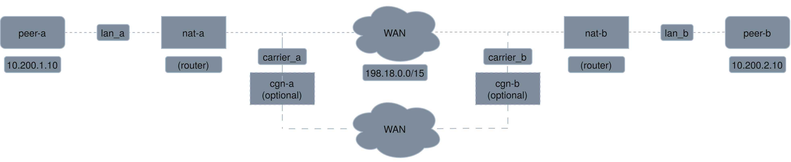

# P2P Testbed

A Docker testbed for the port-hopping vs. relay experiments. Up to 255
peers sit behind real Linux NAT routers (optionally behind carrier-grade NAT too), with
simulated latency, jitter, loss and link capacity between them.



Research question: can synchronized port-hopping on a Noise-encrypted direct
P2P channel give DoS resilience comparable to a TURN relay, while keeping
direct-path latency and throughput, against outside attackers (conventional
and AI-driven) across NAT types? The system under test is a full mesh of
pairwise direct links, compared with the same mesh through a TURN relay.

## Quick start

Needs Linux with Docker Engine and the Compose plugin; see
[docs/testbed.md](docs/testbed.md#requirements) for the kernel and firewall
settings.

```bash
./testbed/prepare-host.sh               # once per boot (uses sudo)
docker compose up -d --build --wait     # build (incl. the Go tools) and start
docker compose exec peer-a punch -genkey /keys/a   # once: static Noise keys for -direct,
docker compose exec peer-b punch -genkey /keys/b   #   kept in ./keys (not in git)
uv run python -m p2prunner smoke        # sanity check (seconds)
uv run python -m p2prunner verify --all # check every NAT type and CGNAT (~1 min)
uv run python -m p2prunner run experiments/punch_path.toml   # an experiment (~20 min)
docker compose down -t 1                # tear down
```

The committed stack has two peers; `uv run python -m p2prunner up --peers 8`
starts a larger one (see [docs/testbed.md](docs/testbed.md#peers)).

## What is where

| Folder | What it is |
|---|---|
| `p2p/` | The system, in Go: rendezvous, STUN, TURN, Noise, the port-hopping direct channel, and `punch`, the peer program. Tests sit beside the code. |
| `testbed/` | The emulated network: router, host and coturn (STUN server and TURN relay) container images, and the host setup script |
| `p2prunner/` | The experiment runner (Python): the address plan and compose file generator, runs experiment files, checks the testbed, writes and reports results |
| `tests/` | The runner's tests (Python `unittest`, no Docker needed) |
| `experiments/` | Experiment files: one `.toml` per experiment |
| `analysis/` | Jupyter notebook for the early experiments |
| `docs/` | Everything else written down (below) |
| `results/` | Run output, one folder per run (not in git) |

## Docs

| File | Read it for |
|---|---|
| [docs/results.md](docs/results.md) | Project status, the results so far (Experiments A and B), and notes for the paper |
| [docs/testbed.md](docs/testbed.md) | Requirements, peers, settings, addresses, how the NAT types and links are built |
| [docs/running.md](docs/running.md) | Running experiments, running `punch` by hand, reading results, the reports |
| [docs/design.md](docs/design.md) | How the system works: code layout, rendezvous, the direct channel, flags and result columns |
| [docs/testing.md](docs/testing.md) | The Go and Python tests, and the fuzzers |
